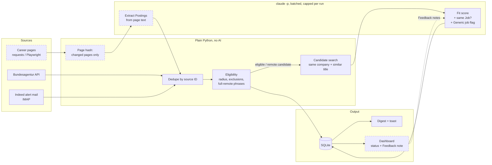

# JobSearch

Daily, mostly automated job discovery for one candidate. It collects postings from the Bundesagentur für Arbeit (and later Indeed alert mails and company career pages), merges duplicates into real openings, decides with plain rules whether a job is in reach, and keeps everything in a local SQLite database. AI scoring runs through Claude Code on a subscription, with no API costs.

The vocabulary is defined in [CONTEXT.md](CONTEXT.md), the main decisions are in [docs/adr](docs/adr/), and the build order is in [docs/implementation-plan.md](docs/implementation-plan.md).

## How the AI is used

The pipeline is script first: plain Python does everything a rule can decide, and Claude only gets the few steps that need judgment ([ADR 0001](docs/adr/0001-script-first-ai-only-for-judgment.md)). The AI runs headless through `claude -p` on a Claude Pro subscription, so there are no API costs, but every call uses quota that is shared with interactive work. That limit shapes the whole design.

**Status:** Phases 1–5 are built: collection from the Bundesagentur and Indeed alert mails, rule-based Eligibility, Fit scoring with Digest and toast, and Job matching with Reopenings. The other AI steps are planned for Phases 8–9 and marked as such below.



Dashed boxes are planned and not built yet.

### Where AI is called

| Step | Model | Input | Output | Phase |
|---|---|---|---|---|
| Fit score for new eligible Jobs (**built**) | Sonnet | Profile, recent Feedback notes, rubric, up to `MAX_SCORED_PER_RUN` Jobs in one call | JSON per Job: tier (★★★/★★/★), German reasoning, matching and missing skills, remote and part-time signals | 3 |
| Same Job across Sources? (**built**) | Sonnet | Candidate pairs found by plain rules | Same Job or not, in the same call as scoring | 4 |
| Generic job flag (**built**) | Sonnet | The Job being scored | Flag that keeps multi-role and recruiter ads out of matching | 4 |
| Extract Postings from career pages | Haiku | Visible text of pages whose hash changed | Posting JSON | 8 |
| Find career pages (one-time setup, with web search) | not fixed yet | Company names | Career URL and ATS type, written back for a human to check | 8 |
| Derive Search terms | not fixed yet | The Profile, only when its hash changes | 5–8 Search terms | 9 |

### Design principles

- **Rules before AI.** Collecting, deduplicating and Eligibility are deterministic. The AI only sees what is left. 
- **Cheap model for mechanical work.** Haiku extracts, Sonnet judges.
- **No browsing in the main loop.** Scoring and extraction run without tools. Python fetches and renders pages itself (Playwright for JavaScript pages) and hands over plain text. The only browsing step is the one-time career page setup, and its result is reviewed by hand.
- **Structured output, checked twice.** Every call passes a JSON schema that the CLI enforces, and the code then checks that every Job in the batch was answered exactly once. Invalid output gets one retry, and quota or login problems raise a clear German error.
- **AI failure never blocks collection.** If scoring fails, the run still counts as collected, the Jobs wait as unscored, and the error is stored with the run.
- **Uncertainty is shown, not hidden.** Jobs scored from a short mail snippet are marked low confidence. Rule decisions store their reason, so wrong filters can be found.
- **Human in the loop.** The candidate sets a Job status with an optional Feedback note in the dashboard, and recent notes go into the next scoring prompt.
- **Tests never call the AI.** `ai.py` is the only module that runs `claude -p`, and tests replace it with a fake.

## Setup

```
python -m venv .venv
.venv\Scripts\python -m pip install -e ".[dev]"
.venv\Scripts\python -m jobsearch init
```

`init` creates `data/`, the database, `.env` and the `private/` files from the examples. Then fill in:

- `.env`: home location and radii, and later the profile path and mail credentials
- `private/companies.csv`: Target companies, with aliases for the names they use in job ads
- `private/exclusions.txt`: title words that rule a job out (internships, theses, ...)
- `private/search_terms.txt`: Search terms

`init` also downloads the GeoNames postal codes for Germany and Switzerland into `data/geo/`, used to place jobs that come with a place name only. They are © GeoNames, licensed under [CC BY 4.0](https://creativecommons.org/licenses/by/4.0/).

`.env`, `private/` and `data/` are gitignored and never leave your machine.

## Usage

```
.venv\Scripts\python -m jobsearch daily    # collect, check Eligibility, fetch descriptions, score, Digest
.venv\Scripts\python -m jobsearch score    # score only (--limit N for a cheap test)
.venv\Scripts\python -m jobsearch status   # counts and the last runs
.venv\Scripts\python -m pytest             # tests, never touch the network
```

## How Eligibility works

- Distances are straight-line from home. Within `RADIUS_KM` is in reach, and within `RADIUS_TARGET_COMPANY_KM` for Target companies.
- A title containing a word from the exclusion list is out.
- Jobs outside the radius are only kept when the posting allows home office *and* the description contains a full-remote phrase ("100% remote", "ortsunabhängig", ...). Those stay `unclear` until the AI scoring confirms them.

Every decision is stored with its reason, including the ineligible ones.
